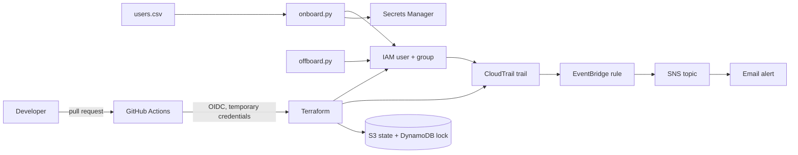

# AWS IAM Automation

User lifecycle automation on AWS: onboarding, offboarding, credential storage and an audit trail, built with Terraform, Python (boto3) and GitHub Actions.

I work in an IAM support team (user onboarding and offboarding, ForgeRock, CyberArk, ServiceNow). This project rebuilds that daily workflow as code, so the same job is repeatable, reviewed in Git and auditable.

## What it does

- **Terraform** creates the stable parts: IAM groups, least-privilege policies, an account password policy, and the audit alerting.
- **Python (boto3)** handles the ticket-driven part: create a user from a CSV row, add them to a group, generate a temporary password, and store it in AWS Secrets Manager. Offboarding removes everything in the order AWS requires.
- **EventBridge + SNS + CloudTrail** send an email whenever an IAM user is created or deleted.
- **GitHub Actions** runs `fmt`, `validate` and `plan` on pull requests and `apply` on merge to `main`, logging in to AWS with OIDC (no stored access keys).

## Architecture



Why it is split this way: groups and policies rarely change, so they live in Terraform. Users change per ticket, so they are driven by a script that a ticketing system could call.

## Tech stack

| Area | Tools |
|---|---|
| Infrastructure as code | Terraform, S3 remote state, DynamoDB locking |
| Scripting | Python 3, boto3 |
| AWS services | IAM, Secrets Manager, CloudTrail, EventBridge, SNS, S3 |
| CI/CD | GitHub Actions with OIDC |

## Repository layout

```
.
├── terraform/main.tf              groups, policies, audit, CloudTrail, OIDC role
├── scripts/
│   ├── onboard.py                 create users from CSV
│   ├── offboard.py                remove users and secrets
│   ├── users.csv                  sample input
│   └── requirements.txt
├── .github/workflows/terraform.yml   CI/CD pipeline
└── docs/images/                   screenshots
```

## Setup

You need an AWS account (use a sandbox), the AWS CLI, Terraform 1.5+, Python 3 and Git. Set a billing alert first.

```bash
# 1. Remote state storage (created once, by hand)
aws s3api create-bucket --bucket <your-tfstate-bucket> --region ap-south-1 \
  --create-bucket-configuration LocationConstraint=ap-south-1
aws s3api put-bucket-versioning --bucket <your-tfstate-bucket> \
  --versioning-configuration Status=Enabled
aws dynamodb create-table --table-name tf-lock \
  --attribute-definitions AttributeName=LockID,AttributeType=S \
  --key-schema AttributeName=LockID,KeyType=HASH \
  --billing-mode PAY_PER_REQUEST --region ap-south-1

# 2. Infrastructure (set your bucket name in the backend block first)
cd terraform
terraform init
terraform plan
terraform apply

# 3. Subscribe your email to the alert topic (region us-east-1), then confirm it
aws sns subscribe --region us-east-1 \
  --topic-arn <iam-user-changes topic ARN> \
  --protocol email --notification-endpoint you@example.com
```

## Usage

```bash
cd scripts
python -m venv .venv
source .venv/Scripts/activate        # Git Bash on Windows
pip install -r requirements.txt

python onboard.py users.csv          # create users, store passwords
python offboard.py test.asha         # remove a user and schedule secret deletion
```

`users.csv` format (all three columns required):

```
username,group,email
test.asha,dev,asha@example.com
```

Onboarding is safe to re-run: existing users are skipped, and rows with missing fields are skipped with a line-numbered error instead of stopping the run.

## CI/CD flow

1. A change to `terraform/` is pushed on a branch and opened as a pull request.
2. The pipeline runs `terraform fmt -check`, `init`, `validate` and `plan`. `apply` is skipped.
3. After review and merge to `main`, the pipeline runs `apply`.

The pipeline assumes an IAM role through GitHub OIDC. AWS issues credentials that last about an hour, and the role's trust policy only accepts tokens from this repository. No AWS keys are stored in GitHub; the only secret is the role ARN.


## Security decisions

- **Least privilege:** groups get read-only managed policies only.
- **No long-lived keys in CI:** OIDC with a trust policy restricted to this repository.
- **Secrets stay out of Git:** passwords go to Secrets Manager. `.gitignore` blocks state files, `.tfvars` and virtual environments. State is stored encrypted in S3.
- **Forced password reset** on first login, and a strong account password policy (14+ characters, expiry, reuse prevention).
- **Recovery window on secrets:** offboarding schedules deletion with 7 days, so an accidental offboarding can be undone.
- **Audit:** CloudTrail logs management events, and EventBridge emails on `CreateUser` and `DeleteUser`.

Known shortcut: the pipeline role has `AdministratorAccess` because this is a sandbox. In a real environment it would be scoped to the services Terraform manages, with a separate read-only role for the plan step.

## Problems I faced

### 1. Re-onboarding a user failed within 7 days of offboarding

**What happened:** After offboarding a user and onboarding the same username again, the script failed at the Secrets Manager step with an error saying the secret was scheduled for deletion.
**Why:** `offboard.py` uses a 7-day recovery window, so the secret name was still taken. `create_secret` rejected it.
**Fix:** `onboard.py` now uses a `store_secret` function that creates the secret, or updates it if it exists, or restores it and writes the new password if it is pending deletion. The recovery window stays on purpose.

### 2. IAM user create/delete alerts never arrived

**What happened:** I built the alert chain (EventBridge rule, SNS topic, email), but no email arrived after creating and deleting users.
**Why (two causes):**
1. IAM is a global service and its events are delivered in us-east-1. My rule and topic were in Mumbai, so the rule never saw the events.
2. A CloudTrail trail must be logging management events in the same region as the rule. AWS documents this. I had no trail.

**How I found it:** I tested each link separately. A direct publish to the SNS topic worked, so the topic, subscription and policy were fine. The rule and target looked correct. The rule's `MatchedEvents` metric was empty, so it never received an event. The Trails page was empty.
**Fix:** Added a second Terraform provider (`alias = "use1"`, us-east-1), moved the SNS topic, rule, target and topic policy to it, and added the CloudTrail trail, its S3 bucket and bucket policy in Terraform.

### 3. GitHub Actions could not assume the AWS role

**What happened:** The pipeline failed at the login step with `Not authorized to perform sts:AssumeRoleWithWebIdentity`. CloudTrail showed AccessDenied with no reason.
**Why:** The trust policy expected the subject `repo:<user>/<repo>:*`, but the GitHub token carried numeric owner and repository IDs in the subject, so the pattern never matched.
**How I found it:** I added a temporary workflow step that printed the token's `sub`, `aud` and `iss` claims and compared them with the trust policy.
**Fix:** Updated the trust policy condition to the exact subject format, still limited to this repository, then removed the debug step.
**Lesson:** When a login fails with no reason, inspect what the other side actually sends instead of re-checking what you configured.

### 4. Half-onboarded user when the group does not exist

**What happened:** I put a group that does not exist in `users.csv`.

**What I saw:** 
```bash
$ python onboard.py users.csv
2026-11-26 09:13:08,785 INFO Found credentials in shared credentials file: ~/.aws/credentials
2026-11-26 09:13:11,831 INFO CREATED secret iam/users/test.good
2026-11-26 09:13:11,831 INFO ONBOARDED user=test.good group=dev
2026-11-26 09:13:12,513 ERROR FAILED user=test.bad err=An error occurred (NoSuchEntity) when calling the AddUserToGroup operation: The group with name devs cannot be found.
(.venv) 
```
**Why:** The script creates the user first and adds the group second, so a failure in the second step can leave a user with no permissions.
**Planned fix:** Check that the group exists before creating the user, or delete the user if a later step fails.

### 5. One malformed CSV row crashed the whole run

**What happened:** A row with a missing email produced `None`, and boto3 raised `ParamValidationError`. The script only caught `ClientError`, so the whole run crashed.
**Fix:** Each row is validated and skipped with a line-numbered error if a field is missing. Exceptions are caught per user, so one bad row does not block the others.

## Cost and cleanup

Everything here fits in the AWS free tier or costs very little. To remove it all:

```bash
cd scripts && python offboard.py <test users>
cd ../terraform && terraform destroy
```

Delete the state bucket and the `tf-lock` table by hand afterwards, since they were created outside Terraform.

## Future improvements

- Automatic secret rotation (Lambda or Secrets Manager rotation)
- A ServiceNow or webhook trigger that calls the onboarding script
- Replace IAM users with SSO / federation
- Roll back the user if a later onboarding step fails
- Scope the pipeline role down from `AdministratorAccess`
- Move Terraform locking to native S3 locking (`use_lockfile`), since `dynamodb_table` is deprecated in newer Terraform versions
- Unit tests for the Python scripts with mocked AWS calls

## What I learned

Terraform state, locking and `for_each`; how global AWS services behave across regions; how OIDC federation replaces stored keys; and how to debug a silent failure by testing each link in a chain.
